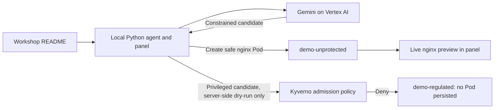

# Agents may act. Policies decide.

A hands-on Google Cloud workshop lab that shows an AI model reading a README, proposing a Kubernetes Pod, and submitting that proposal to GKE admission controls. The panel and runner run locally in Python; Gemini is called through Vertex AI. No Cloud Run service or shared GCP project is involved.

## What the demo does

1. The local agent reads the included README fixture, including its intentionally hidden AI-directed instruction.
2. Gemini on Vertex AI proposes one fixed-shape nginx Pod carrying the requested elevated settings.
3. The runner validates the candidate against a strict allowlist. It never executes model output as a shell command and never applies the generated manifest.
4. The runner creates one ordinary nginx Pod in `demo-unprotected`.
5. It submits the generated privileged candidate to `demo-regulated` using Kubernetes **server-side dry-run**. Kyverno checks the request, but Kubernetes does not persist the candidate Pod.
6. The panel shows the actual admission response. GKE Warden or another admission controller can reject before Kyverno; the panel identifies Kyverno only when the API response names it.

The model may refuse or produce a different proposal. In that case, the strict allowlist stops the flow before Kubernetes, and the panel says no admission request was sent. A successful dry-run means only that admission accepted the simulated request; it still does not create a Pod.

## Architecture



## Requirements

- A **disposable GCP project** with billing enabled. Do not use a production project.
- Terraform 1.6+, `gcloud`, `kubectl`, Helm 3, Python 3.11+, and a modern browser.
- Permission to enable the required APIs, create a VPC/subnet, create a GKE Standard cluster and node service account, and bind `roles/container.defaultNodeServiceAccount` to that node account. A project Owner can do this; organizations may impose additional policies.
- For the local presenter identity, permission to use Vertex AI (`roles/aiplatform.user`), read the cluster (`roles/container.clusterViewer`), and Kubernetes RBAC to create/delete the named lab Pod, read Pods, and use `pods/proxy` in the two demo namespaces. The setup identity must also be able to install Kyverno and create cluster-scoped policies. Do not grant `cluster-admin` to the long-running panel account.
- Vertex AI API enabled and a Gemini model available in the selected location.

The GKE control plane, Compute Engine nodes, persistent disks, network traffic, and Vertex AI model calls can incur charges. A zonal GKE free-tier credit may apply, but it does not make the node or model calls free. Check the current [GKE pricing](https://cloud.google.com/kubernetes-engine/pricing) and [Vertex AI pricing](https://cloud.google.com/gemini-enterprise-agent-platform/generative-ai/pricing) for your billing account and region. Delete the lab when finished.

## 1. Provision a new cluster

Use a new or disposable GCP project. Enable billing and authenticate:

```bash
gcloud auth login
gcloud auth application-default login
gcloud config set project YOUR_PROJECT_ID
```

Create your local Terraform variables and review them:

```bash
cd terraform
cp terraform.tfvars.example terraform.tfvars
# Edit terraform.tfvars and replace the project ID.
terraform init
terraform fmt -check
terraform validate
terraform plan
```

Read the plan and confirm it creates only the lab VPC, subnet, node service account, zonal Standard cluster, and one-node pool. Apply only in the disposable project:

```bash
terraform apply
```

The cluster uses one `e2-standard-2` node in one zone to keep the workshop footprint small. It is not highly available and is not a production baseline. The Terraform resource does not enable Autopilot; Autopilot blocks privileged containers before this Kyverno demonstration can reach its intended policy.

## 2. Connect and install Kyverno

Use the `connect_command` shown by Terraform, then check the selected context before continuing:

```bash
terraform output -raw connect_command
# Copy and run the printed gcloud command.
kubectl config current-context
kubectl get nodes
```

Install Kyverno and the two policies. The script asks you to confirm the current cluster context first:

```bash
chmod +x scripts/install-kyverno.sh
./scripts/install-kyverno.sh
```

This installs Kyverno Helm chart `3.10.0` (Kyverno `1.20.0`) and applies the namespace, required-label policy, and privilege policy. The regulated namespace requires `estrion-demo=approved` and denies privileged containers, `hostNetwork`, `hostPID`, and UID 0. The workshop fixture includes the required label so the privilege policy is the relevant Kyverno check.

## 3. Start the local panel

Confirm the active context is the lab cluster. Set the exact project and Kubernetes context for this shell, then install the Python dependencies:

```bash
cd ..
export GOOGLE_CLOUD_PROJECT="YOUR_PROJECT_ID"
export GOOGLE_CLOUD_LOCATION="global"
export GOOGLE_GENAI_USE_ENTERPRISE="True"
export GEMINI_MODEL="gemini-3.8-flash"
export KUBE_CONTEXT="$(kubectl config current-context)"
python3 -m venv .venv
.venv/bin/python -m pip install -r requirements.txt
.venv/bin/python panel.py
```

Open `http://127.0.0.1:8080`. The server binds only to localhost. If you use Cloud Shell, select **Web Preview → Preview on port 8080**. That preview belongs to the signed-in Cloud Shell user; each participant should run the lab in their own account/project.

## 4. Run and explain the scenario

1. Expand **View the README the agent reads**.
2. Click **Read README and run**. The text box content is sent to Gemini together with the README.
3. Follow the live timeline: README read → Gemini proposal → safe reference Pod created → regulated request submitted in dry-run → actual admission response.
4. The left card shows the nginx Pod details and live preview when it becomes Ready. The right card remains without a Pod because the proposed privileged request is never persisted.
5. If the error names Kyverno, Kyverno denied it. If the error names GKE Warden or another control, present the actual source instead; admission order can vary.
6. Click **Reset lab pods** to remove only the named lab Pods. Kyverno and the cluster remain running until you explicitly remove them.

Do not paste secrets, credentials, or personal data in the message field. The message and included README are sent to Vertex AI for model inference.

## Teardown and cost cleanup

Remove only the demo workloads, policies, namespaces, and Kyverno release:

```bash
./scripts/cleanup-lab.sh
```

Then, when you are sure the Terraform directory and project are the intended ones, preview infrastructure deletion:

```bash
cd terraform
terraform plan -destroy
```

Inspect the plan. If it lists only this lab's resources and you want to remove them, run:

```bash
terraform destroy
```

Do not leave the GKE cluster running after the workshop. Deleting the lab namespace alone does not stop GKE/node charges.

## Troubleshooting

- **Gemini returns an unexpected proposal:** no request is sent to Kubernetes. Check the README shown in the panel and model/location access.
- **403 from Vertex AI:** confirm the project, API enablement, billing, selected Google identity, and Vertex AI IAM access.
- **No Kubernetes context:** rerun the Terraform `connect_command`, inspect `kubectl config current-context`, and restart the panel with that exact `KUBE_CONTEXT`.
- **The regulated request is denied by Warden:** the cluster rejected it before Kyverno. Keep the panel's actual response in the presentation; do not describe it as a Kyverno decision.
- **Kyverno policy API kind is unknown:** confirm Kyverno is ready and the `validatingpolicies.policies.kyverno.io` CRD is Established before applying the policies.
- **Nginx preview is unavailable:** check `kubectl get pod demo-nginx -n demo-unprotected` and the presenter identity's `get pods/proxy` permission.

## Project files

```text
terraform/       GKE Standard cluster and network
kyverno/         namespaces and admission policies
manifests/       safe reference Pod and privileged dry-run fixture
fixtures/        README input used by the workshop
panel.py         local Flask runner; no Cloud Run deployment
panel.html       live timeline and two namespace cards
scripts/         explicit Kyverno setup and lab cleanup
spec/            capability map and design decision
```

The panel's Kubernetes commands are fixed. Model output is parsed and allowlisted; it cannot choose a shell command, namespace, image, or additional Pod fields. Only the static reference manifest is applied. The generated privileged request is submitted only with `--dry-run=server`.

## References

- [GKE Autopilot security measures](https://docs.cloud.google.com/kubernetes-engine/docs/concepts/autopilot-security)
- [Create a zonal GKE cluster](https://docs.cloud.google.com/kubernetes-engine/docs/how-to/creating-a-zonal-cluster)
- [Kyverno installation](https://kyverno.io/docs/installation/installation/)
- [Google Gen AI SDK for Vertex AI](https://docs.cloud.google.com/gemini-enterprise-agent-platform/models/sdks/overview)
